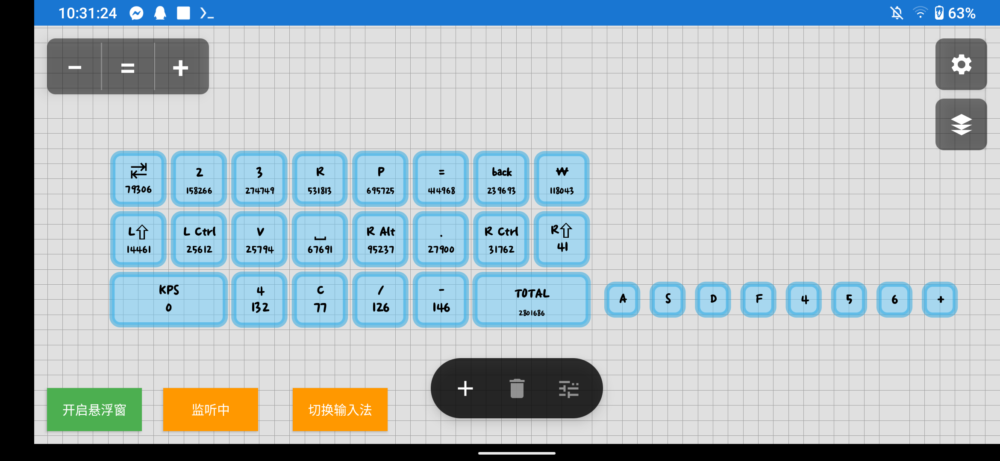

# KeyViewer

> 面向节奏游戏与键盘展示场景的跨平台按键可视化、统计、映射与悬浮窗工具。

[](https://github.com/leoleo0980627-web/keyviewer-android/releases/latest)


[](LICENSE)

KeyViewer 可以在后台读取实体键盘输入，把按键状态、每键计数、KPS、TOTAL 和键雨渲染到编辑画布或透明悬浮窗。Windows、Android 与 Linux 共用同一套 Avalonia UI、配置模型和输入路由；各平台只保留必要的底层输入与悬浮窗实现差异。



## 当前发布状态

| 平台 | 发布包 | 输入后端 | 当前状态 |
| --- | --- | --- | --- |
| Windows 10/11 x64 | `KeyViewer-Windows-x64.exe` | 全局低级键盘钩子 | 主要支持平台；单文件、自带运行时，支持后台监听、拦截与映射 |
| Android 7.0+ arm64 | `KeyViewer-Android-arm64.apk` | 无障碍（默认）/ Shizuku / Root-Sui | 默认免配对显示实体键盘、计数、KPS 与键雨；Shizuku 或 UID 0 的 Sui 后端提供拦截与映射 |
| Android x86_64 | `KeyViewer-Android-x86_64.apk` | 同上 | 用于 x86_64 模拟器，不适用于普通 ARM 手机 |
| Linux x64 | `KeyViewer-Linux-x64.tar.gz` | `evdev` + `uinput` | 实验性支持；需要 `/dev/input` 读取权限，拦截/映射还需要 `/dev/uinput` 写入权限 |

发布包请从 [GitHub Releases](https://github.com/leoleo0980627-web/keyviewer-android/releases/latest) 下载。Windows EXE 与 Linux 包为自包含构建，不需要另行安装 .NET；Android APK 目前为项目签名的侧载包，不通过应用商店分发。

Android 三种后端的能力边界如下：

| 模式 | 首次准备 | 按键显示/绑定/统计 | 映射、鬼键、防抖、限制 |
| --- | --- | --- | --- |
| 无障碍（新安装默认） | 在系统设置启用“KeyViewer 键盘监听”，无需 Shizuku 配对 | 支持实体键盘，只读并原样透传 | 不支持；打开相关开关时会显示模式切换提示 |
| Shizuku | 安装并启动 Shizuku，非 Root 设备通常需无线调试配对并授权 KeyViewer | 支持 | 在 ROM 允许访问 `/dev/input` 与 `/dev/uinput` 时支持 |
| Root / Sui | Root 设备安装 Magisk Sui 并授权，后端 UID 必须为 0 | 支持 | 设计为完整功能且免无线调试配对；仍需在真实 Root 设备验证 ROM 兼容性 |

当前源码状态已经通过 79 个核心测试、Windows Release 构建、Android Bridge lint，以及 arm64/x86_64 Release APK 构建。Android API 30 x86_64 模拟器已验证冷启动、无障碍实体按键计数与 KPS 自动回零；Samsung SM-A326BR（Android 13、arm64）已验证侧载、受限设置处理、无障碍服务绑定、沉浸式全屏，以及应用前台悬浮窗拖动。Root / Sui 仍明确保留为待 Root 真机验证路径。

## 功能概览

### 画布与布局编辑

- 添加、删除、复制、粘贴和绑定按键。
- 拖动整个世界坐标画布，围绕指针缩放，随时重置视口。
- 7.5 dp 细网格吸附；导入或切换旧配置时，以整个布局为单位对齐最近网格，再修正残余的单键误差。
- 单键移动、缩放和图层调整；批量编辑支持框选、全选、整组移动与属性覆盖。
- 批量编辑以第一颗已选按键作为基准；没有明确修改的字段保持原值，允许有选择地覆盖全部选中按键。
- 图层列表支持拖动排序、手动顺序和按 Y 坐标自动排列：画面越靠下的按键图层越高。
- 深色/浅色主题切换及过渡动画；主编辑画布可使用自定义背景图片，悬浮窗保持透明。

### 按键外观

- 独立设置放开/按下状态的填充色、边框色、文字色和计数颜色。
- 自定义宽高、圆角、边框宽度、显示文字和是否显示计数。
- 文字与数字可分别设置字号、X/Y 偏移；长计数会根据实际字宽自动收缩，避免轻易越出边框。
- 文字自动适配，以及颜色、偏移、模糊半径均可调的文字阴影。
- 内置 ADOFAI、MapleStory Bold 与系统字体选择；也可把 OTF/TTF 字体导入配置。
- 支持 PNG、JPEG、WebP、GIF 按键图片，并可选择图片是否取代键名。
- KPS/TOTAL 支持单行/换行、文字与数值独立样式、全大写/首字母大写/全小写。

### 键雨与统计

- 每键键雨开关、颜色、宽度、X/Y 偏移和泛光半径。
- 每个配置独立保存统一键雨速度；全局设置中可调整最大高度、预留高度与圆角。
- 每键按下次数可直接编辑、归零并写入配置。
- TOTAL 在加载、切换和保存配置时由全部非负按键计数重新计算，运行中按新的按下事件增量更新。
- KPS 使用一秒单调时间滑动窗口，只统计有效的首次 DOWN；不计 REPEAT/UP，并由到期计时器主动刷新回 0。

### 输入路由

默认状态只在后台观察并完整透传输入。只有明确打开下面的功能时，KeyViewer 才会拦截或替换对应按键：

- **按键映射**：为单个按键打开开关并绑定目标键；来源键不会再额外送到前台程序。
- **鬼键**：仍在 KV 中显示、计数和生成键雨，但不把输入传给系统或游戏。
- **弹键防抖**：在设定时间内吞掉过快的第二次系统输入，同时保留 KV 的视觉反馈。
- **按键限制**：打开后拦截所有不在当前画布中的按键；额外名单还能强制拦截画布中已有的指定键。
- **系统键保护**：Esc、左 Windows、右 Windows 永久放行，不能加入强制拦截名单。

路由优先级为：按键限制 → 系统键保护 → 插件过滤器 → 画布匹配 → 鬼键 → 防抖 → 映射 → 普通透传。映射会保留 DOWN / REPEAT / UP 时序；多个来源映射到同一个目标时使用引用计数，避免其中一颗放开造成目标键提前弹起。

### 配置、预设与素材

- 首次启动内置 `Jipper 16K`、`Jipper 12K`、`Jipper 10K`，默认顺序为 16K → 12K → 10K。
- 配置支持新建、即时切换、重命名、删除、上移/下移和恢复内置预设。
- 导出默认使用当前配置名称；导入会覆盖当前配置，不会覆盖其他配置。
- 配置格式为 `formatVersion: 4`。单个 JSON 可内嵌字体、按键图片等可携素材，带 SHA-256 校验，并保持旧配置兼容。
- 单个素材上限 12 MiB，单份配置内嵌素材合计上限 48 MiB。
- 深色模式、背景图、输入保护、悬浮窗位置等全局设置保存在独立的 `global-settings.json`，不会混入或随 KV 布局导入导出。
- `default` 是保留配置名，不能删除或重命名。

### 悬浮窗

- 主编辑器和透明悬浮窗共享同一份实时按键状态与渲染数据。
- 悬浮窗可拖动并保存位置，可调整整体缩放；滚轮不会穿透悬浮窗去缩放编辑画布。
- Windows 悬浮窗不接受键盘焦点，也不会出现在 Alt+Tab 切换列表中。
- 关闭主窗口时会同步关闭悬浮窗、释放全局输入钩子和仍处于按下状态的映射键。

### 插件与游戏桥接

仓库包含实验性的 C# 插件 API、示例插件与 BepInEx 6 桥接：

- `KeyViewer.Abstractions`：稳定的小型输入事件、过滤器与插件接口层，目标框架为 `netstandard2.0`。
- `KeyViewer.SamplePlugin`：最小输入过滤器示例。
- `KeyViewer.BepInExBridge`：通过命名管道把游戏内事件送到桌面端；其他模组可调用 `KeyViewerBridge.PublishKey()`。
- 插件可放入数据目录的 `Plugins`，或程序旁的 `Plugins` 目录。

插件系统当前主要用于输入事件与路由扩展，还不是任意改写整个 UI 的稳定模组 SDK；插件 API 版本目前为 `1.0`。

## 安装与首次使用

### Windows

1. 从 Releases 下载 `KeyViewer-Windows-x64.exe`。
2. 直接运行 EXE。它是未进行商业代码签名的独立单文件，Windows SmartScreen 可能第一次显示提示。
3. 点击按键，打开“按键设置”，再点“绑定按键”，随后按下实体键盘上的目标键。
4. 点击“开启悬浮窗”查看透明输出；不需要时关闭悬浮窗或退出主程序。

Windows 默认只读监听。请在已经确认配置正确后再开启鬼键、映射或按键限制，避免在聊天、开发工具等前台程序中意外拦截输入。

### Android

1. ARM 手机/平板安装 `KeyViewer-Android-arm64.apk`；只有 x86_64 模拟器才安装 `KeyViewer-Android-x86_64.apk`。
2. 新安装默认选择“无障碍（免 Shizuku）”，按应用内按钮打开系统无障碍设置并启用“KeyViewer 键盘监听”。此模式不读取屏幕内容，也不拦截或修改输入。
3. Android 13+ 可能对侧载 APK 显示“受限设置/限制设置”：前往“设置 → 应用程序 → KeyViewer → 右上角更多”，先选择“允许受限设置”，再返回无障碍页面启用服务。不同 ROM 的文字可能略有差异。
4. 允许“在其他应用上层显示”权限以使用悬浮窗。
5. Android 编辑器以沉浸式横屏显示且不保留三边系统白框；从屏幕边缘滑动仍可临时唤出系统栏。
6. 悬浮窗在编辑器前台或其他应用前台都可以直接拖动。悬浮窗矩形外的触控会传给下层应用，矩形内用于拖动悬浮窗。
7. 连接实体键盘，在“全局设置”或“输入来源”中确认监听已启动，再进行按键绑定。
8. 需要映射、鬼键、防抖或按键限制时，切换到 Shizuku 完整模式；Root 用户也可安装 Magisk Sui，选择“Root / Sui”使用 UID 0 后端而无需无线调试配对。

无障碍、Shizuku 与 Root/Sui 三种后端互斥运行，不会重复计算同一次按键。在无障碍模式中开启需要拦截的功能时，应用会用自身 Avalonia UI 提示“取消 / Root-Sui / Shizuku”；切换模式不会自动安装、配对或替用户确认系统授权。Android 的免 root 映射依赖 shell 身份能够访问 `/dev/input/event*` 与 `/dev/uinput`。某些厂商 ROM 即使 Shizuku 已授权仍会被 SELinux 拒绝；这属于设备环境限制，不代表无障碍显示与配置编辑一定失效。

### Linux

```bash
tar -xzf KeyViewer-Linux-x64.tar.gz
chmod +x KeyViewer.Desktop
./KeyViewer.Desktop
```

普通可视化至少需要读取键盘对应的 `/dev/input/event*`。映射、鬼键和限制还需要 `/dev/uinput`；推荐通过 `input` 组或精确的 udev 规则授权，不要长期以 root 运行整个桌面程序。若自动发现选错设备，可在 `global-settings.json` 的 `linuxInputDevice` 中用分号分隔指定设备路径。

## 基本操作

| 操作 | 结果 |
| --- | --- |
| 单击按键 | 选择并打开该按键的设置基准 |
| 拖动按键 | 移动按键并吸附网格 |
| 拖动空白画布 | 平移整个世界坐标 |
| 鼠标滚轮 / `+` / `−` | 以指针位置或画布中心缩放 |
| `=` | 重置画布视口 |
| 批量编辑 → 选择 → 全选 | 以第一颗已选按键为基准全选并编辑 |
| 复制 → 粘贴 | 进入粘贴预览，确认后生成新的按键 ID |
| 图层 → 自动排列 | 按 Y 轴由上到下同步排序渲染与命中图层 |

## 数据目录

| 平台 | 默认路径 |
| --- | --- |
| Windows | `%LOCALAPPDATA%\KeyViewer` |
| Linux | `$XDG_CONFIG_HOME/KeyViewer`，未设置时为 `~/.config/KeyViewer` |
| Android | 应用私有数据目录 |

桌面端可使用环境变量 `KEYVIEWER_DATA_ROOT` 覆盖数据目录，方便制作便携测试环境。主要文件包括：

```text
KeyViewer/
├─ Configs/                 # 多配置 JSON
├─ Assets/                  # 导入并提取的图片与字体
├─ Plugins/                 # C# 插件
├─ PluginData/              # 插件私有数据
├─ active-config.txt        # 当前配置名
├─ config-order.json        # 配置排序
├─ current.kv.json          # 当前配置兼容副本
└─ global-settings.json     # 不随布局导入导出的全局设置
```

## 从源码构建

### 环境

- .NET SDK `10.0.302`（版本由 `global.json` 固定）。
- Android Studio JBR / Java 17+（当前验证环境为 JBR 21）、Android SDK、NDK `27.3.13750724` 和 CMake（仅 Android）。
- Windows 上的 Android Gradle 构建请让 `JAVA_HOME` 指向 Android Studio JBR。

### 还原、测试和桌面构建

```powershell
dotnet restore .\desktop\KeyViewer.Desktop.sln
dotnet build .\desktop\src\KeyViewer.Desktop\KeyViewer.Desktop.csproj -c Release
dotnet test .\desktop\tests\KeyViewer.Core.Tests\KeyViewer.Core.Tests.csproj -c Release

# Windows x64 自包含单文件
dotnet publish .\desktop\src\KeyViewer.Desktop\KeyViewer.Desktop.csproj `
  -c Release -r win-x64 --self-contained true -p:PublishSingleFile=true

# Linux x64 自包含目录
dotnet publish .\desktop\src\KeyViewer.Desktop\KeyViewer.Desktop.csproj `
  -c Release -r linux-x64 --self-contained true
```

### Android 构建

```powershell
$jbrPath = 'C:\Program Files\Android\Android Studio\jbr'
$androidSdkPath = "$env:LOCALAPPDATA\Android\Sdk"
$androidProject = '.\desktop\src\KeyViewer.Android\KeyViewer.Android.csproj'
$env:JAVA_HOME = $jbrPath

.\gradlew.bat :android-bridge:assembleDebug :android-bridge:lintDebug

dotnet restore $androidProject -r android-arm64
dotnet publish $androidProject -c Release -r android-arm64 --no-restore `
  -p:JavaSdkDirectory="$jbrPath" -p:AndroidSdkDirectory="$androidSdkPath"

dotnet restore $androidProject -r android-x64
dotnet publish $androidProject -c Release -r android-x64 --no-restore `
  -p:JavaSdkDirectory="$jbrPath" -p:AndroidSdkDirectory="$androidSdkPath"
```

`app/` 保留原生 Android 实现、输入服务、资源、预设与回归测试；当前发布 APK 的跨平台 UI 入口位于 `desktop/src/KeyViewer.Android`，通过 `android-bridge` 复用 Android 输入能力。

## 仓库结构

```text
.
├─ app/                          # Android 输入实现、资源、预设与旧 UI 参考
├─ android-bridge/               # 提供给 .NET Android 的 Java/AAR 输入桥
└─ desktop/
   ├─ src/KeyViewer.Abstractions # 插件和输入源公共接口
   ├─ src/KeyViewer.Core         # 配置、状态、路由、Windows/Linux 输入后端
   ├─ src/KeyViewer.UI           # Windows/Android/Linux 共用 Avalonia UI
   ├─ src/KeyViewer.Desktop      # Windows/Linux 桌面入口和悬浮窗
   ├─ src/KeyViewer.Android      # Avalonia Android 入口和悬浮窗服务
   ├─ src/KeyViewer.BepInExBridge
   ├─ src/KeyViewer.SamplePlugin
   └─ tests/KeyViewer.Core.Tests
```

## 已知限制

- 键盘本身的 6KRO、冲突键或固件丢键无法由软件补出。
- Windows/Linux 发布包目前没有商业代码签名；Android APK 也不是应用商店签名渠道。
- 真机 Android 的 `/dev/input`、`/dev/uinput` 与 SELinux 行为随 ROM 而异，发布前的构建、签名和模拟器验证不能替代每一种实体设备测试。
- Android 系统同时只会把实体按键过滤能力交给一个无障碍服务；若其他服务已经请求过滤按键，KeyViewer 可能无法收到事件。软键盘和纯触控输入通常也不会产生可观察的实体 `KeyEvent`。
- Root / Sui 路径已完成代码、构建和权限状态检查，但当前发布前验证环境没有 Root 真机；不要把“构建通过”等同于已经验证所有 Root ROM。
- Linux 后端已经实现 `evdev/uinput` 路由，但本项目当前主要在 Windows 与 Android 环境开发，Linux 仍应视为实验性平台。
- 外部素材会增加 JSON 和内存占用；请遵守素材大小限制，避免把超大动画图当作按键图。
- 旧版原生 Android 与当前跨平台 UI 同时保留在仓库中；正式发布包以 Releases 中标明的文件为准。

## 安全说明

KeyViewer 的映射、鬼键与按键限制需要系统级输入能力；Android 无障碍模式始终只读并原样透传。启用会拦截输入的功能前，请确保画布里至少保留必要按键；若配置异常，先用受保护的 Esc/Windows 键退出当前操作，再关闭监听或程序。不要从不可信来源安装插件、配置或替换过的 APK/EXE。

## 参与开发

提交问题时请附上平台、系统版本、发布包名称、输入设备、复现步骤，以及是否开启映射/鬼键/防抖/按键限制。Android 问题还请注明当前后端（无障碍 / Shizuku / Root-Sui）、授权状态、设备 ABI 与 ROM；Linux 问题请注明实际使用的 `event*` 和 `/dev/uinput` 权限。

## License

本项目使用 [MIT License](LICENSE)。
